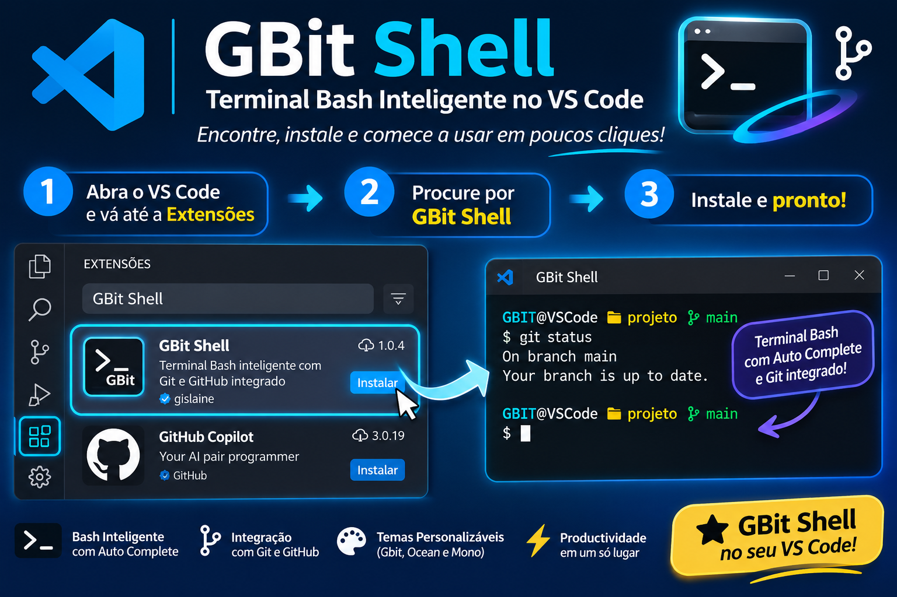

<p align="center">
  
</p>

<h1 align="center">GBit Shell para VS Code</h1>

<p align="center">
  Adicione o GBit Shell à lista de terminais integrados do VS Code.
</p>

<p align="center">
  Terminal interativo moderno para desenvolvimento — prompt inteligente, integração com Git, autocompletar contextual, comandos de produtividade e perfil próprio no VS Code.
</p>

<p align="center">
  
  
  
  
  
</p>

---

## O que é o GBit Shell?

GBit Shell é uma alternativa de terminal para quem já utiliza Git Bash, PowerShell ou Zsh.

Ele funciona sobre o shell do sistema operacional, preservando a compatibilidade com os comandos habituais e acrescentando recursos de produtividade, como:

- Prompt inteligente com informações do usuário, diretório e Git.
- Autocompletar contextual de comandos, arquivos, branches e scripts.
- Integração com Git e GitHub.
- Publicação de projetos no GitHub com o comando `ghpush`.
- Comandos de produtividade, como `ports` e `killport`.
- Temas personalizáveis e configuração por projeto.
- Integração com o terminal do Visual Studio Code.

É um shell interativo desenvolvido em Python, compatível com Windows, macOS e Linux.

## Terminal GBit Shell em execução

O prompt apresenta informações úteis durante o desenvolvimento:

```bash
gislaine@DESKTOP-D1QAMU7   GBIT   ~/web3-hub   (main)
❯
```

<p align="center">
  
</p>

Cada elemento do prompt tem uma função: usuário e máquina, identificação GBIT, diretório atual, estado do Git, ambiente virtual Python e identificação de projetos Node.js.

---

## GBit Shell diretamente no VS Code

Utilize o GBit Shell como um terminal integrado ao Visual Studio Code, ao lado de opções como PowerShell, CMD e Git Bash.

<p align="center">
  
</p>

---

## Instalação

### Via npx

Execute sem precisar instalar o pacote permanentemente:

```bash
npx gbit-shell
```

### Via npm

Instalação global:

```bash
npm install -g gbit-shell
```

### Via pip

Instalação pelo Python:

```bash
pip install gbit-shell
```

### Atualização

```bash
python -m pip install --upgrade gbit-shell
```

### Abrir o terminal

Depois da instalação:

```bash
gbit
```

---

## Integração com o VS Code

O GBit Shell pode ser integrado ao Visual Studio Code como um perfil próprio de terminal.

Depois de instalar o pacote, execute dentro do GBit Shell:

```bash
vscode
```

Para gerar o arquivo VSIX sem instalar automaticamente:

```bash
vscode --build
```

Para abrir a ajuda dos comandos:

```bash
help
```

---

## Publicação no GitHub

O comando `ghpush` simplifica o processo de publicação de projetos:

```bash
ghpush
```

Com mensagem personalizada:

```bash
ghpush -m "feat: nova versão"
```

Com repositório existente:

```bash
ghpush --remote https://github.com/usuario/repositorio.git
```

---

## Tecnologias

- Python
- Node.js
- npm
- Git
- GitHub CLI
- Visual Studio Code

---

## Licença

MIT

## Autora

Gislaine Lopes

GitHub: [https://github.com/Gislaine-web3/gbit-shell](https://github.com/Gislaine-web3/gbit-shell)

.mit gislainelophes@gmail.com


