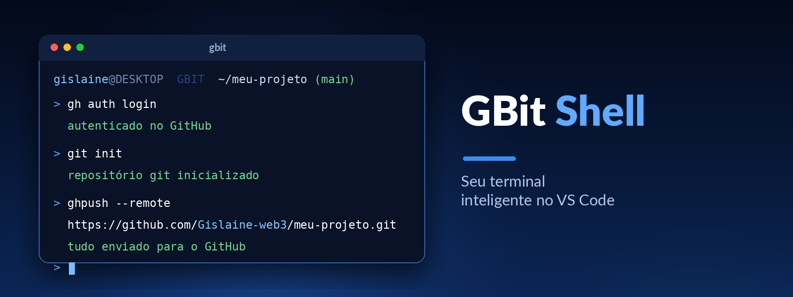

<p align="center">
  
</p>

<h1 align="center">GBit Shell</h1>

<p align="center">
  <strong>Seu terminal. Seus comandos. Mais produtividade.</strong><br>
  Autocomplete contextual, integração com Git e GitHub e comandos próprios para o desenvolvimento.
</p>

<p align="center">
  Disponível como extensão para o VS Code e como CLI pelo npm.
</p>

<p align="center">
  <a href="https://marketplace.visualstudio.com/search?term=GBit%20Shell&target=VSCode&category=All%20categories&sortBy=Relevance">
    
  </a>
  <a href="https://www.npmjs.com/package/gbit-shell">
    
  </a>
  <a href="https://github.com/Gislaine-web3/gbit-shell">
    
  </a>
  <a href="#-licença">
    
  </a>
</p>

<p align="center">
  <a href="https://www.npmjs.com/package/gbit-shell">
    
  </a>
  <a href="https://github.com/Gislaine-web3/gbit-shell/stargazers">
    
  </a>
  <a href="https://github.com/Gislaine-web3/gbit-shell/issues">
    
  </a>
</p>

<p align="center">
  <a href="#-comece-aqui">Comece aqui</a>
  &nbsp; • &nbsp;
  <a href="#-autocomplete-e-prompt">Autocomplete</a>
  &nbsp; • &nbsp;
  <a href="#-git-e-github">Git e GitHub</a>
  &nbsp; • &nbsp;
  <a href="#-comandos">Comandos</a>
  &nbsp; • &nbsp;
  <a href="https://github.com/Gislaine-web3/gbit-shell/issues">Reportar problema</a>
</p>

---

<p align="center">

</p


## ✨ O que é o GBit Shell?

GBit Shell é um shell interativo desenvolvido em Python para tornar o trabalho no terminal mais organizado e produtivo.

Ele acrescenta autocomplete contextual, informações úteis no prompt e comandos próprios para tarefas frequentes, mantendo o uso dos comandos habituais disponíveis no ambiente do sistema.

Você pode utilizá-lo de duas formas:

| Opção | Como usar |
| :--- | :--- |
| 💻 Extensão do VS Code | Adicione o GBit Shell à lista de terminais integrados do editor |
| ⚡ CLI pelo npm | Abra o GBit Shell a partir do terminal com `npx` ou instalação global |

O projeto também oferece instalação pelo Python com `pip`.

### Principais recursos

- ⌨️ Autocomplete contextual de comandos, arquivos, branches e scripts.
- 🧭 Prompt com informações de usuário, máquina, diretório e Git.
- 🌿 Uso dos comandos normais do Git.
- 🚀 Comando próprio `ghpush` para simplificar a publicação de projetos no GitHub.
- 🌐 Comando `serve` para trabalhar com a visualização local de projetos.
- 🔌 Comandos `ports` e `killport` para tarefas relacionadas a portas.
- 🎨 Temas personalizáveis e configuração por projeto.
- 💻 Perfil de terminal integrado ao VS Code.
- 🐍 Indicadores de ambiente virtual Python e identificação de projetos Node.js no prompt.

Compatível com Windows, macOS e Linux, conforme a proposta do projeto.

## 🚀 Comece aqui

### 💻 Opção 1 — extensão do VS Code

A extensão GBit Shell está publicada no Visual Studio Marketplace.

1. Abra o VS Code.
2. Acesse **Extensions** com `Ctrl + Shift + X`.
3. Pesquise por **GBit Shell**.
4. Identifique a extensão deste projeto e clique em **Install**.
5. Abra a paleta de comandos com `Ctrl + Shift + P`.
6. Execute **Terminal: Create New Terminal (With Profile)**.
7. Selecione o perfil **GBit Shell**.

[Encontrar a extensão no Marketplace →](https://marketplace.visualstudio.com/search?term=GBit%20Shell&target=VSCode&category=All%20categories&sortBy=Relevance)

> Caso o perfil não apareça imediatamente após a instalação, recarregue a janela do VS Code e consulte as instruções da extensão.

## 💻 Integração com o VS Code

Utilize o GBit Shell como um perfil próprio de terminal, ao lado de opções como PowerShell, CMD e Git Bash.

<p align="center">
  
</p>

### ⚡ Opção 2 — executar pelo npm

Para abrir sem uma instalação global permanente:

```bash
npx gbit-shell
```

Para instalar globalmente:

```bash
npm install -g gbit-shell
```

Depois, abra com:

```bash
gbit
```

 E Abaixa a extensao do vscode usando o cli 


```bash
vscode
```

Para atualizar a instalação global do npm:

```bash
npm install -g gbit-shell@latest
```

### 🐍 Alternativa — instalação pelo Python

Requisito informado pelo projeto: **Python 3.9 ou superior**.

Instale com:

```bash
python -m pip install gbit-shell
```

Abra o terminal:

```bash
gbit
```

 Abrir a extensao do vscode com o cli:


```bash
vscode
```
 
Para atualizar:

```bash
python -m pip install --upgrade gbit-shell
```

> Escolha uma forma de instalação e mantenha a atualização pelo mesmo gerenciador para facilitar a identificação da versão em uso.

## ⌨️ Autocomplete e prompt

O GBit Shell apresenta informações úteis diretamente no prompt:

```text
gislaine@DESKTOP-D1QAMU7   GBIT   ~/web3-hub   (main)
❯
```

Conforme o contexto do projeto, o prompt pode apresentar:

| Informação | Finalidade |
| :--- | :--- |
| Usuário e máquina | Identificar o ambiente atual |
| `GBIT` | Identificar o shell |
| Diretório | Mostrar a pasta em que você está trabalhando |
| Branch Git | Indicar a branch atual, como `main` |
| Estado do repositório | Ajudar a acompanhar alterações no projeto |
| Ambiente Python | Identificar o ambiente virtual |
| Projeto Node.js | Apresentar informações relacionadas ao projeto |

O autocomplete contextual auxilia na descoberta e no preenchimento de comandos, caminhos, branches e scripts.

<p align="center">
  
</p>

## 🌿 Git e GitHub

Você escolhe como trabalhar: com os comandos próprios do GBit Shell ou com o fluxo normal do Git.

### 🚀 Publicar usando `ghpush`

Dentro da pasta do projeto:


```bash
gh auth login
```


```bash
git init
```

Para informar um repositório remoto e enviar todo o projeto de uma vez:

```bash
ghpush --remote  https://github.com/Gislaine-web3/gbit-shell.git
```


Com uma mensagem de commit personalizada:

```bash
ghpush -m "Atualiza Readme"
```

ou para commit:

```bash
 ghpush -m "docs: atualiza README"
```


```bash
ghpush
```


O comando reúne etapas do fluxo de publicação, conforme o estado do projeto e a configuração do ambiente.


<p align="center">
  
</p>

> Revise as alterações antes de executar comandos de publicação. Não envie senhas, tokens, arquivos `.env` com segredos ou outras credenciais para o repositório.

### 🛠️ Trabalhar com Git normalmente

Você também pode utilizar os comandos tradicionais:

```bash
git status
git add .
git commit -m "feat: atualiza o projeto"
git push
```

Outros exemplos:

```bash
# Ver as branches
git branch

# Criar e acessar uma branch
git switch -c minha-funcionalidade

# Consultar o histórico
git log --oneline
```

> Os exemplos dependem do estado do repositório. O envio com `git push` exige um remoto configurado e autenticação válida.

### 🔐 Autenticação com GitHub CLI

Para os recursos que utilizam a GitHub CLI, configure a autenticação com:

```bash
gh auth login
```

Confira a sessão:

```bash
gh auth status
```

A autenticação da GitHub CLI é separada da instalação do GBit Shell.

## 🌐 Servidor local e portas

Além do fluxo de Git, o GBit Shell inclui comandos próprios para tarefas locais:

| Comando | Finalidade |
| :--- | :--- |
| `serve` | Trabalhar com a visualização de projetos no navegador por servidor local |
| `ports` | Consultar informações sobre portas |
| `killport` | Encerrar o processo associado a uma porta, conforme a sintaxe do comando |

Para consultar as opções disponíveis na sua versão, abra a ajuda dentro do GBit Shell:

```bash
help
```


### Integração pela CLI

Além da instalação pelo Marketplace, o projeto disponibiliza um fluxo de integração pela CLI.

Dentro do GBit Shell:

```bash
vscode
```

Para gerar o arquivo VSIX sem instalar automaticamente:

```bash
vscode --build
```

> Para o uso cotidiano da extensão publicada, prefira a instalação pelo Marketplace. O fluxo de geração de VSIX é uma alternativa para instalação local e desenvolvimento.

## 📋 Comandos

### Executados no terminal do sistema

| Comando | O que faz |
| :--- | :--- |
| `npx gbit-shell` | Executa o GBit Shell pelo npm |
| `npm install -g gbit-shell` | Instala a CLI globalmente pelo npm |
| `gbit` | Abre o shell após a instalação |
| `vscode` | Abre o terminal gbit  shell após a instalação |
| `python -m pip install gbit-shell` | Instala pelo Python |
| `gh auth login` | Inicia a autenticação da GitHub CLI |

### Comandos próprios, dentro do GBit Shell

| Comando | O que faz |
| :--- | :--- |
| `help` | Exibe a ajuda |
| `ghpush` | Inicia o fluxo simplificado de publicação no GitHub |
| `ghpush -m "mensagem"` | Usa uma mensagem de commit personalizada |
| `ghpush --remote <url>` | Informa o endereço do repositório remoto |
| `serve` | Acessa o recurso de servidor local |
| `ports` | Consulta informações sobre portas |
| `killport` | Acessa o recurso de encerramento por porta |
| `vscode` | Executa a integração com o VS Code |
| `vscode --build` | Gera o pacote VSIX |

> Consulte `help` para conferir argumentos e opções da versão instalada.

## 🧩 Tecnologias e integrações

| Tecnologia | Papel no projeto |
| :--- | :--- |
| Python | Implementação do shell interativo |
| Node.js e npm | Distribuição e execução pela CLI npm |
| Git | Versionamento de projetos |
| GitHub CLI | Recursos de autenticação e integração com GitHub |
| Visual Studio Code | Extensão e perfil de terminal |

## 🛟 Ajuda e problemas

Encontrou um erro?

Antes de abrir uma issue, reúna:

- Sistema operacional.
- Forma de instalação: extensão, npm ou pip.
- Versão instalada.
- Comando executado.
- Resultado esperado.
- Mensagem de erro.
- Passos para reproduzir.

Não inclua tokens, senhas ou dados sensíveis nos logs.

[Reportar um problema →](https://github.com/Gislaine-web3/gbit-shell/issues)

## 🌱 Ecossistema GBit

GBit Shell faz parte do **ecossistema GBit**, que reúne ferramentas para desenvolvimento, automação e produtividade.

- [Conhecer o portfólio](https://gislaine-web3.github.io/gbit-ecossistema/)
- [Explorar o repositório do ecossistema](https://github.com/Gislaine-web3/gbit-ecossistema)
- [Acessar o pacote no npm](https://www.npmjs.com/package/gbit-shell)

## 👩‍💻 Autora

**Gislaine Cristina Lopes**

- GitHub: [Gislaine-web3](https://github.com/Gislaine-web3)
- Repositório: [gbit-shell](https://github.com/Gislaine-web3/gbit-shell)
- Contato: [gislainelophes@gmail.com](mailto:gislainelophes@gmail.com)

## 📄 Licença

Distribuído sob a licença **MIT**.

MIT © Gislaine Cristina Lopes.

Consulte o arquivo de licença incluído no repositório para os termos completos.

---

<p align="center">
  <strong>GBit Shell — menos etapas, mais desenvolvimento.</strong><br>
  Uma ferramenta do ecossistema GBit.
</p>
