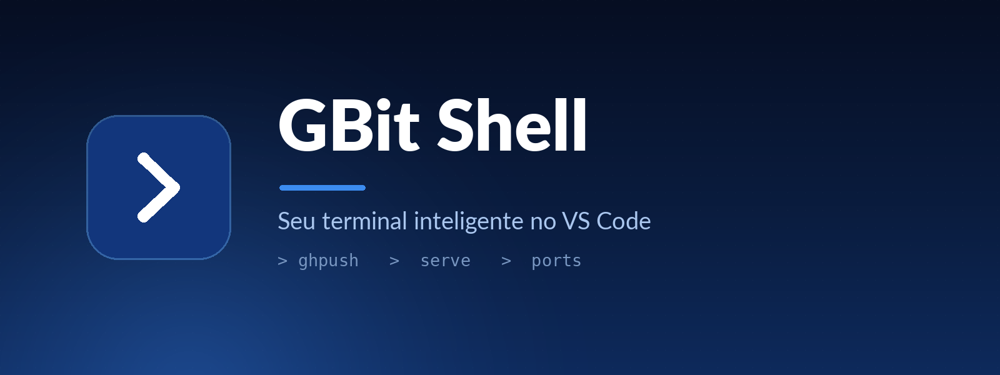
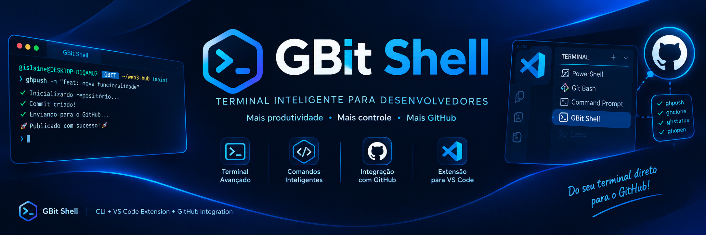

# Por que o banner nao apareceu (e como resolver)

## O diagnostico

O pacote 1.0.3 estava certo: os dois banners estavam dentro do `.vsix`, e o
`README.md` apontava para eles com caminho relativo (`assets/banner-gbit-shell.png`).

O problema e outro, e tem duas causas somadas:

1. **O Marketplace nao serve imagem local.** Ele monta a pagina web a partir do
   README, mas nao publica os arquivos `assets/`. Caminho relativo funciona no
   GitHub e dentro do VS Code (aba de detalhes da extensao), porque la os
   arquivos existem. Na web, a imagem quebra e aparece so o texto alternativo.
2. **Se a extensao ainda nao esta publicada**, o que voce ve e a aba de detalhes
   local do VS Code. Se ela abriu antes do Reload Window, o VS Code estava
   mostrando o README em cache da versao antiga.

## Solucao A — hospedar o banner e usar URL completa (recomendado)

O nome do arquivo tem que ser longo e unico, para nao colidir com nada:

```
gbit-shell-banner-topo-2026.png
gbit-shell-banner-terminal-2026.png
```

1. Suba os dois PNGs no repo `Gislaine-web3/gbit-shell` (pode ser na raiz ou em `docs/`).
2. Abra cada um no GitHub, clique em **Download**, copie o endereco que aparece na barra
   (formato `https://raw.githubusercontent.com/Gislaine-web3/gbit-shell/main/...`).
3. No `README.md`, troque:

```html

```

por:

```html

```

4. Rode `npx @vscode/vsce package` de novo e reinstale o `.vsix`.

Dica: `main` funciona, mas se voce criar uma tag `v1.0.4` e usar
`.../refs/tags/v1.0.4/...` o link nunca quebra se o arquivo for renomeado depois.

## Solucao B — sem depender de hospedagem

Se nao quiser subir nada agora, o banner de texto (ASCII) sempre renderiza:

```
  ____  ____  _ _     ____  _          _ _
 / ___|| __ )(_) |_  / ___|| |__   ___| | |
| |  _ |  _ \| | __| \___ \| '_ \ / _ \ | |
| |_| || |_) | | |_   ___) | | | |  __/ | |
 \____||____/|_|\__| |____/|_| |_|\___|_|_|
```

## Checklist antes de publicar

```bash
# 1. a versao esta certa?
grep '"version"' package.json

# 2. o README de dentro do pacote tem a URL nova?
unzip -p gislaine.gbit-shell-terminal-1.0.4.vsix README.md | grep -n "img src"

# 3. publicar
npx @vscode/vsce publish
```

O passo 2 e o mais importante: e o README **de dentro do `.vsix`** que vai para
web. Editar o README da pasta depois de empacotar nao muda o que foi publicado.
